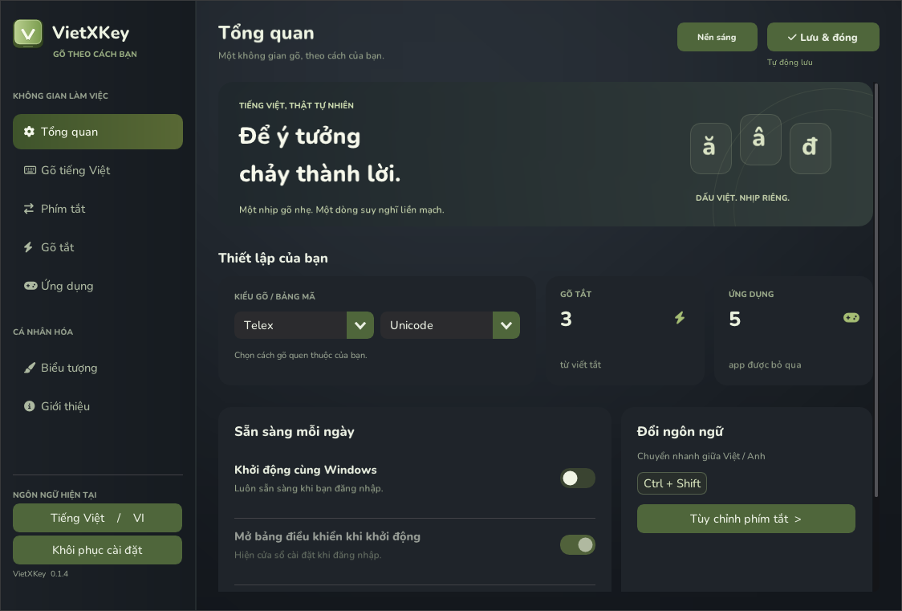

# VietXKey

**Bộ gõ tiếng Việt gọn nhẹ và gần gũi, dành cho Windows.**

Fix lỗi và phát triển thêm bởi **Minh Tâm Đoàn**, từ dự án [VietFlow của VietFlow Team](https://github.com/KienPC1234/VietFlow). Lõi gõ kế thừa thuật toán UniKey của Phạm Kim Long.

[Trang giới thiệu](https://tiemcuoimay2025.github.io/VietXKey/) · [Tải bản Windows x64](https://tiemcuoimay2025.github.io/VietXKey/downloads/VietXKey-windows-x64.zip) · [Góp ý / báo lỗi](https://github.com/tiemcuoimay2025/VietXKey/issues)

<p align="center"></p>
<p align="center"></p>

## Tính năng

- Telex, VNI, nhiều bảng mã và phím chuyển Việt / Anh tùy chọn.
- Gõ tắt, với mẫu mặc định `vxk` → `VietXKey`.
- Thiết lập riêng theo ứng dụng và danh sách ứng dụng bỏ qua.
- Giao diện **sáng / tối**, nền chuyển sắc mềm, font Nunito chữ lớn và điểm nhấn xanh rêu. Lưu lựa chọn cho lần mở sau.
- Giữ từ tiếng Anh, phụ âm ngoại lai và tùy chọn giữ dấu khi viết không chuẩn chính tả.
- Khởi động cùng Windows, với tùy chọn mở bảng điều khiển khi đăng nhập.
- Bộ gõ thông thường qua Windows Hook; tùy chọn Text Services Framework (TSF) do Windows quản lý.

Các bản sửa trong nhánh này gồm tổ hợp Ctrl+Shift ba phím, khôi phục tiếng Anh theo từng từ, Telex `WWindows`, `DDaf Nawngx`, `zeef`, `ofh` / `ohf`, `zoo` và việc thay chữ trong ô nhập Chromium / Comet. Phạm vi và các ca kiểm tra nằm trong [docs/INPUT_FIXES.md](docs/INPUT_FIXES.md).

## Sử dụng

1. Tải gói ZIP Windows x64 từ trang giới thiệu.
2. Giải nén, giữ `VietXKey.exe` và `vietxkey_tsf.dll` cùng thư mục.
3. Mở `VietXKey.exe`, chọn kiểu gõ và bảng mã. Đóng bảng điều khiển để tiếp tục chạy ở khay hệ thống.

Mở EXE thủ công hoặc chạy lại với quyền quản trị sẽ hiện bảng điều khiển. Tùy chọn mở bảng điều khiển khi khởi động cùng Windows chỉ áp dụng khi đăng nhập. Chi tiết: [docs/STARTUP_SETTINGS.md](docs/STARTUP_SETTINGS.md).

Cài đặt được lưu vào `vietxkey_config.json`. Cấu hình VietFlow cũ hợp lệ được di chuyển an toàn; file gốc được giữ. Thoát bản đang chạy trước khi thay cả EXE và DLL. Nếu DLL đang bị một ứng dụng giữ, đóng ứng dụng đó rồi cập nhật và mở lại.

**Phạm vi bản tải:** portable Windows x64. Chưa phát hành MSI VietXKey, macOS hoặc Linux. Trong TSF, danh sách từ tiếng Anh tùy chỉnh / xóa từ hiện chưa được áp dụng; TSF dùng quy tắc tiếng Anh có sẵn. Hai chế độ cùng nhận tùy chọn giữ dấu không chuẩn chính tả.

## Build từ mã nguồn

Cần Windows, Rust stable (MSVC), Visual Studio 2022 Desktop development with C++, Windows SDK và CMake 3.20 trở lên. Dùng PowerShell có `cargo`, `cmake` và `git` trong PATH.

```powershell
git clone --recurse-submodules https://github.com/tiemcuoimay2025/VietXKey.git
cd VietXKey
./scripts/build-vietxkey.ps1
```

Script chạy kiểm thử workspace, build UI C++ với CRT tĩnh, EXE Rust và TSF DLL x64. Kết quả tại `dist/VietXKey-x64/`. Các tên crate, C ABI và IPC nội bộ vẫn dùng VietFlow để giữ tính tương thích.

Kiểm tra cấu hình C++ riêng:

```powershell
cmake -S ui_imgui -B ui_imgui/build -DVIETFLOW_BUILD_CONFIG_TESTS=ON -DVIETFLOW_STATIC_CRT=ON
cmake --build ui_imgui/build --config Release
ctest --test-dir ui_imgui/build -C Release --output-on-failure
```

Script `scripts/generate-brand-assets.py` chỉ dành cho người bảo trì muốn xuất lại logo SVG/PNG/ICO, cần Pillow và Node.js + sharp. Build thông thường dùng sẵn tài nguyên đã commit.

## Website

`site/` là trang tĩnh HTML/CSS/JavaScript, không cần bundler. Chạy thử từ thư mục dự án:

```powershell
python -m http.server 8080 --directory site
```

Mở `http://localhost:8080`. GitHub Actions trong `.github/workflows/pages.yml` triển khai thư mục này lên GitHub Pages khi `site/` thay đổi trên `main`. Gói ZIP trong `site/downloads/` là bản x64 được kiểm tra, có SHA256 đi kèm. Workflow build ứng dụng riêng chạy thủ công hoặc khi có pull request, không tự phát hành Release.

## Cấu trúc

| Thư mục | Nội dung |
| --- | --- |
| `core/` | Lõi gõ Rust std và kiểm thử |
| `platforms/windows/` | Host Windows, Hook, khay hệ thống, cấu hình |
| `platforms/windows_tsf/` | DLL Text Services Framework |
| `ui_imgui/` | Bảng điều khiển C++ / Dear ImGui / DirectX 11 |
| `ffi/` | Giao diện C ABI |
| `assets/` | Logo và ảnh giao diện |
| `site/` | Trang giới thiệu và bản tải Windows x64 |

## Nguồn gốc và giấy phép

VietXKey giữ lịch sử Git của [VietFlow](https://github.com/KienPC1234/VietFlow), bản nền v0.1.4, và giấy phép [GPL-3.0-or-later](LICENSE). Thuật toán tiếng Việt kế thừa UniKey của Phạm Kim Long. Những thay đổi và phạm vi kiểm chứng của VietXKey được ghi trong [docs/UI_MOSS.md](docs/UI_MOSS.md) và [docs/BRANDING.md](docs/BRANDING.md).

Font Nunito được phân phối theo SIL Open Font License; các font, Dear ImGui và nlohmann/json giữ giấy phép riêng trong mã nguồn và gói portable. Logo phím V và giao diện VietXKey được dựng riêng, lấy cảm hứng từ nền chuyển sắc và hình khối phím của [Gau](https://gau.io.vn/), không dùng tài nguyên thương hiệu Gau.

Nút **Ủng hộ tác giả** trong ứng dụng và website hiển thị mã QR do Minh Tâm Đoàn cung cấp.
